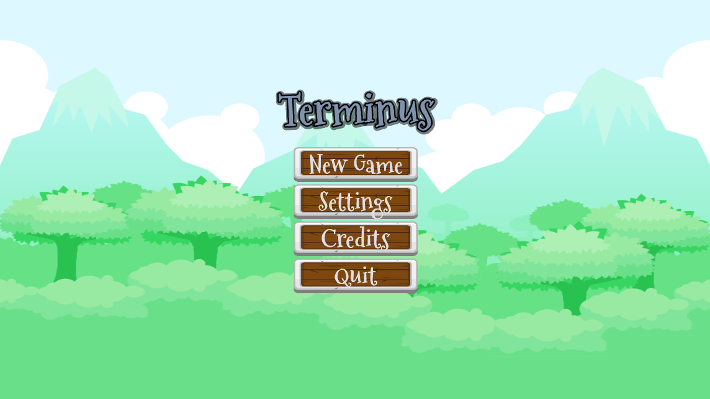
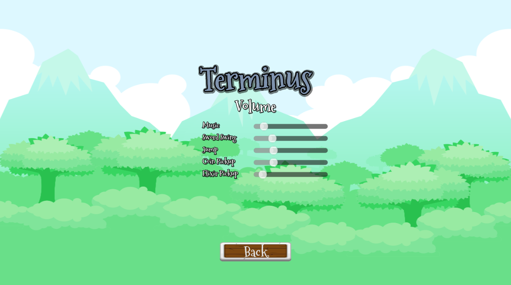
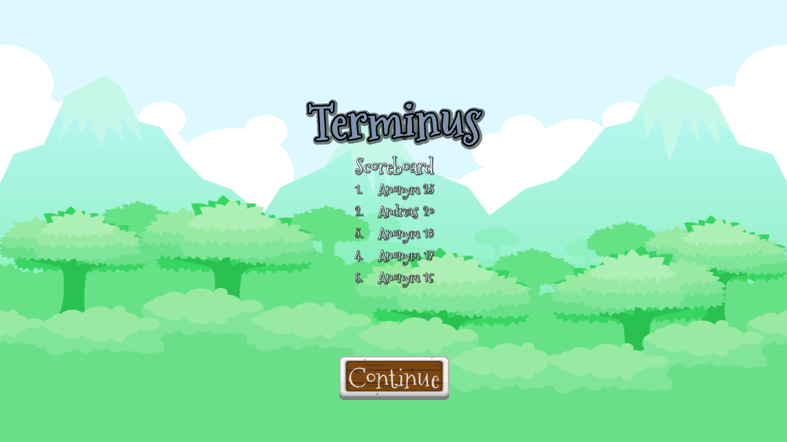
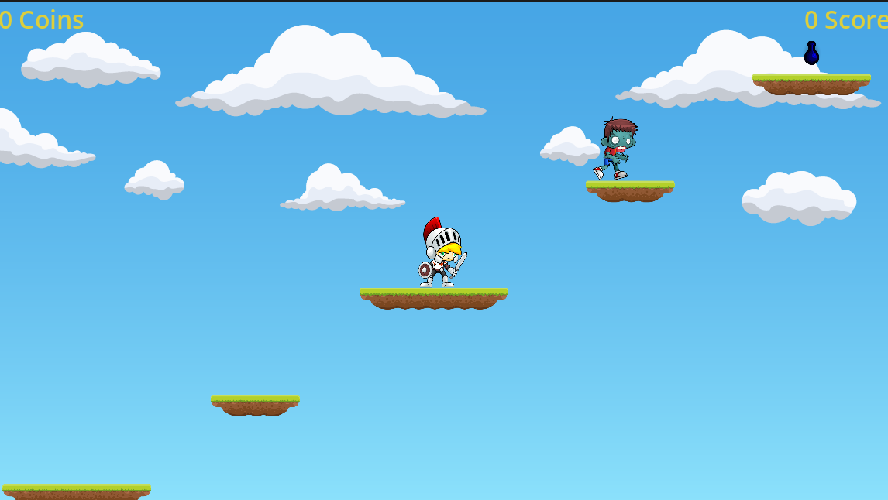
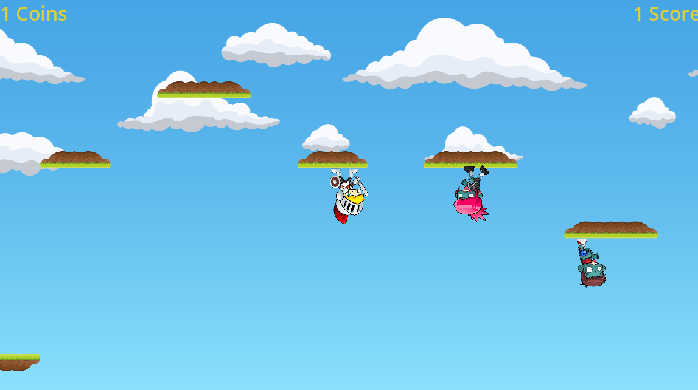
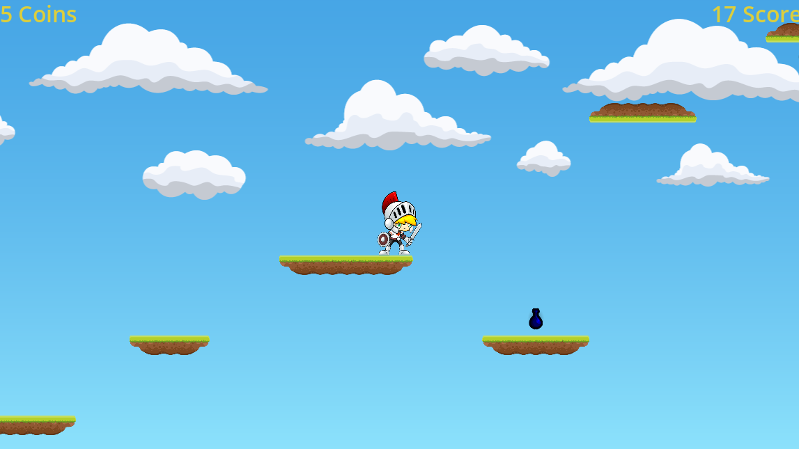

# Terminus
Implementation of the platformer Terminus as part of a university software engineering project at TU Dortmund.

## How to play
For Windows operating systems download [Terminus_Windows.exe](https://github.com/mxcoderr/platformer-terminus/releases/download/Release/Terminus_Windows.exe).

For Linux operating systems download [Terminus_Linux.x86_64](https://github.com/mxcoderr/platformer-terminus/releases/download/Release/Terminus_Linux.x86_64).

## Screenshots

| Main Menu                  	| Settings            				| Scoreboard                      |
|-------------------------------|-----------------------------------|---------------------------------|
|  |  |  |

| Game 1                         | Game 2                         | Game 3                         |
|--------------------------------|--------------------------------|--------------------------------|
|       |       |    |

## About the Project
Terminus is a platformer in which the player tries to achieve the highest score by picking up coins and killing zombies.
The project was developed as part of the Fachprojekt "Digital Entertainment Technologies (Godot)" at TU Dortmund.

## Contribution
Tr0n3x:
* Implementation of the player mechanics (move, jump, attack, death)
* Implementation of the graphical user interface
* Implementation of the world generation (including seeds)
* Implementation of a scoring system
* Implementation of a debug system
* Implementation of sounds and music

mxcoderr:
* Implementation of enemies (female and male zombies)
* Implementation of pickups and their effects (coins, elixirs)
* Optimizing world generation

## Technologies
* Godot Engine
* GDScript
* GDShader